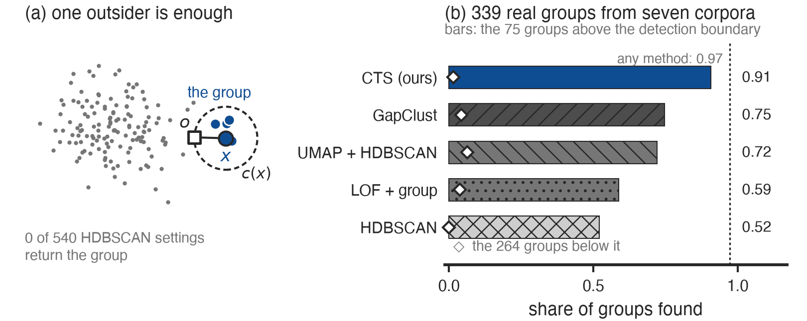
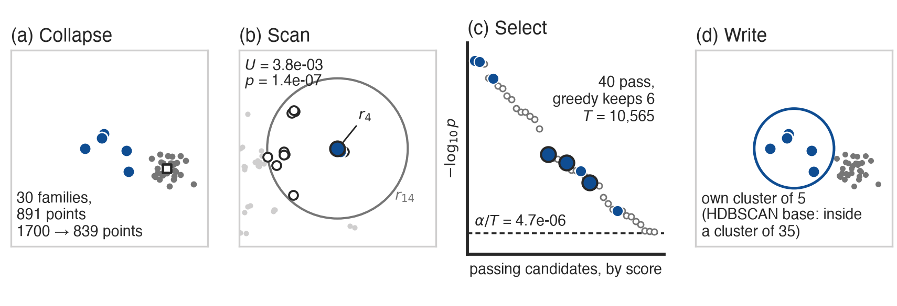
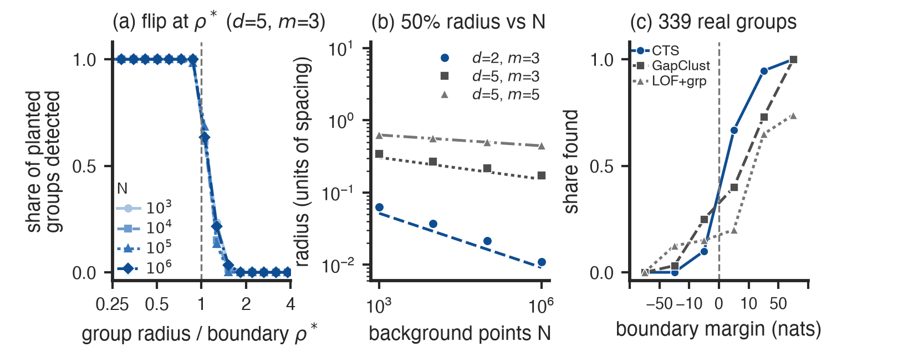
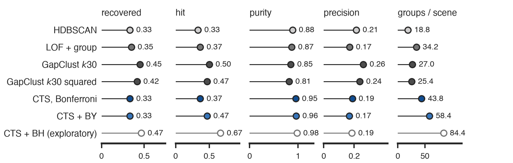

# Small groups below the resolution floor: masking, a detection boundary, and an exact scan

Felipe Provezano Coutinho — [ORCID 0000-0001-7206-5856](https://orcid.org/0000-0001-7206-5856)

This repository holds the code behind the paper's experiments and figures, the generator for its synthetic benchmark (`tinybench`), and a few stored result files.

Groups of 2 to 15 points can be missed for reasons no tuning fixes. The paper calls this *masking* and proves it for HDBSCAN: given a group of at most the neighbourhood size, with one member that has a denser outsider nearby, no level, selection rule or minimum cluster size returns the group. The cause is structural, not a setting you have not tried yet.

The paper does three things. It characterises masking. It proves a *detection boundary* for its own local scan: over a Poisson background, no test detects such a group beyond a constant multiple of that radius. And it gives the matching test, **CTS** (collapse, then scan), an exact density-free ratio of neighbour distances with a false-alarm bound under uneven density. Each returned group comes with a p-value rather than a tuning story.



*Masking and recovery on real data. (a) A tight group of four points sits beside a large diffuse blob with one outlier between them; 0 of 540 HDBSCAN settings return the group. (b) Recovery across 339 real groups from seven corpora. Bars show the share found among the 75 groups above the detection boundary: CTS 0.91, GapClust 0.75, UMAP + HDBSCAN 0.72, LOF + group 0.59, and HDBSCAN 0.52. The dotted line marks 0.97, the share found by at least one method. Small diamonds mark each method's share on the 264 groups below the boundary; all sit near zero.*

## How CTS works

CTS runs in four steps. First, it collapses near-duplicate points so duplicate spikes do not distort local distances. Next, it scans each point's neighbourhood using inner and outer neighbour radii to form a test statistic and p-value without assuming a density model. It then filters passing candidates against a multiple-testing threshold and applies a greedy rule to keep non-overlapping groups. Finally, it writes each surviving group out as its own cluster alongside a base partition.



*CTS in four steps on one real scene, left to right. (a) Collapse: near-duplicate points are merged across 30 families and 891 points, reducing 1700 points to 839. (b) Scan: one candidate's neighbourhood, showing the radius to its 4th neighbour inside the radius to its 14th; the statistic U = 3.8e-03 gives p = 1.4e-07. (c) Select: passing candidates ordered by score, with divisor T = 10,565 and threshold alpha/T = 4.7e-06; 40 pass and a greedy rule keeps 6. (d) Write: the group of 5 becomes its own cluster, where the HDBSCAN base had it inside a cluster of 35.*

## The detection boundary

Recoverability depends on the group's radius relative to the background, not on parameter luck. In planted experiments, detection drops sharply from 1.0 to 0.0 as that radius crosses the predicted boundary, in the same place across background sizes from 10^3 to 10^6 points. On real corpora the margin to the boundary tracks what CTS, GapClust and LOF + group each find, and below it none of the three recovers the groups.



*The detection boundary. (a) On planted groups, the share detected flips sharply from 1.0 to 0.0 as group radius crosses the predicted boundary, at the same place for background sizes of 10^3, 10^4, 10^5 and 10^6 points. (b) The radius at which half the groups are found, plotted against background size for three settings. (c) On the same 339 real groups, the margin to the boundary predicts what CTS, GapClust and LOF + group each find; all three rise together as the margin grows.*

## Where CTS does not lead

CTS does not dominate on every data set. On KDD Cup 99 scenes, CTS with Bonferroni recovers 0.33 of the groups, matching HDBSCAN and trailing GapClust k30 at 0.45. Its precision (0.19) is also below GapClust's (0.26). CTS leads here on purity (0.95 against 0.85 for GapClust and 0.88 for HDBSCAN). An exploratory BH variant recovers 0.47, at 84.4 groups per scene against Bonferroni's 43.8.



*Results on KDD Cup 99 scenes across five measures and seven methods. CTS with Bonferroni recovers 0.33 of the groups, the same as HDBSCAN and below GapClust k30 at 0.45. CTS leads on purity at 0.95 against GapClust's 0.85 and HDBSCAN's 0.88, while its precision (0.19) sits below GapClust's (0.26). An exploratory BH variant recovers 0.47 at 84.4 groups per scene against Bonferroni's 43.8.*

## What the p-values do not guarantee

Do not read the per-group error rate as guaranteed. The paper's free-selection result holds for a candidate family fixed before the scores are seen. In these runs, the divisor counts the pairs left eligible after near-duplicate collapse. Because that count is realised from the data rather than fixed in advance, the premise does not hold as run, and the paper does not bound what that costs in level. Treat `alpha` here as buying a stringent threshold, not a certified group-level error rate.

## Try it

The tests and figure scripts were run on Python 3.11 with `requirements.txt`. Regenerating three of the paper's figures from the stored files in `results/` needs no data download:

```bash
python3.11 -m venv .venv && . .venv/bin/activate && pip install -r requirements.txt
PYTHONPATH=. python figures/make_figures.py
```

`figures/make_figures.py` writes outputs to `figures/regenerated/`. That writes the detection-boundary figure, the tier comparison and the predicted-versus-measured check. The 18 values plotted in the last of those are typed into the script; `python figures/check_fig4_cells.py` traces each one back to `results/p1math_null.json`. The scikit-learn comparison figure is made by `PYTHONPATH=. python figures/skl_compare.py`; it differs from the copy in `figures/paper/`, which predates a correction to near-duplicate handling. See `REPRODUCE.txt` for all commands, unit tests, run statuses, and which runners download public data sets.

## Repository layout

| Path | Contents |
| --- | --- |
| `clustering/eval/nature/` | Implementation: benchmark scenes, CTS (`tiny_methods.py`, `cts3`), baselines, paired-bootstrap statistics, and experiment runners. |
| `clustering/tests/` | Unit tests of the shipped modules (`pytest`). |
| `tinybench/` | Installable benchmark generator, with its own README, data cards and tests. |
| `figures/` | `make_figures.py` (boundary, tiers, predicted-versus-measured), `check_fig4_cells.py`, `skl_compare.py` (the scikit-learn comparison), `rgt_predicted_vs_actual.py`, `figures/paper/` and `figures/readme/`. |
| `results/` | Stored result files read by the figure scripts and analysis step. |
| `requirements.txt` | Package versions used for the tests and figure scripts. |
| `REPRODUCE.txt` | Commands and which of them were run end to end. |

## Not included

- **GapClust.** The official package is GPL-3, so its Python ports were removed from this MIT deposit (`clustering/eval/nature/tiny_baselines.py`, `p3_gapclust_full.py`, `tinybench` baselines). Those functions are stubs that raise `GapClustUnavailable`; set `GAPCLUST_PY` to your own port to use them. Stored GapClust results are kept, but cannot be regenerated from this deposit alone.
- **Public data sets.** KDD Cup 99, single-cell data, OpenML tables and similar data sets are downloaded from their original hosts on first use (set `TG_DATA` to choose the folder), under their upstream licences.
- **Other per-scene results.** Per-scene result files for the other experiment families and the scripts that summarise them.
- **External toolchains.** Code paths exist for baselines requiring a Java or R toolchain (original McCatch and GapClust code), but the tools are not shipped.
- **Unrelated diagnostic.** An optional few-label diagnostic from another project was removed from `tiny_bench.py`; it needed two unshipped modules and nothing in the paper's experiments used it.

## Licence

See tinybench/LICENSE. Code: MIT. Generated benchmark data and offset library: CC BY 4.0. Data derived from KDD Cup 99 (UCI) and 10X Genomics PBMC keeps its upstream terms (see the data cards). The same text is in LICENSE at the deposit root.

## Citation

Cite the archived deposit by its all-versions DOI: `10.5281/zenodo.24286673`. Machine-readable metadata is in `CITATION.cff`. The paper that uses this code is under review and has no DOI yet; it will be added when it exists.
